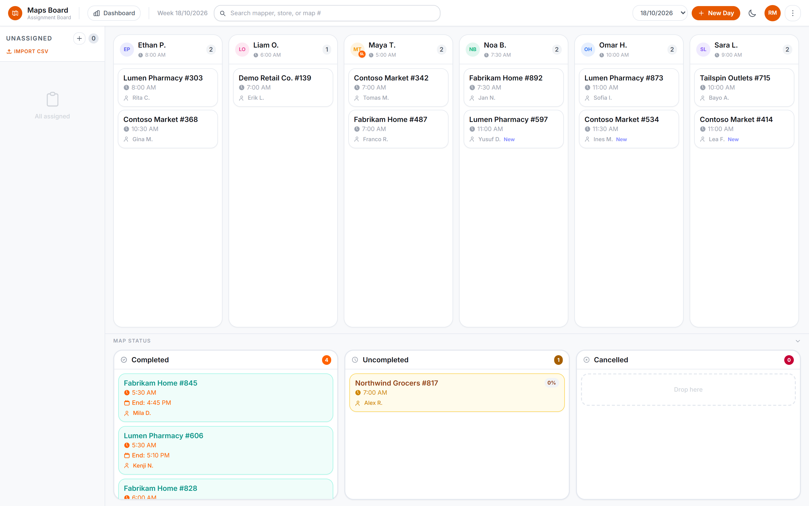
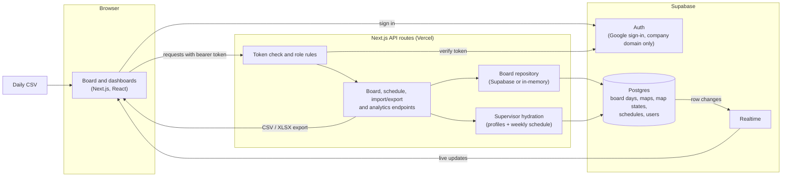
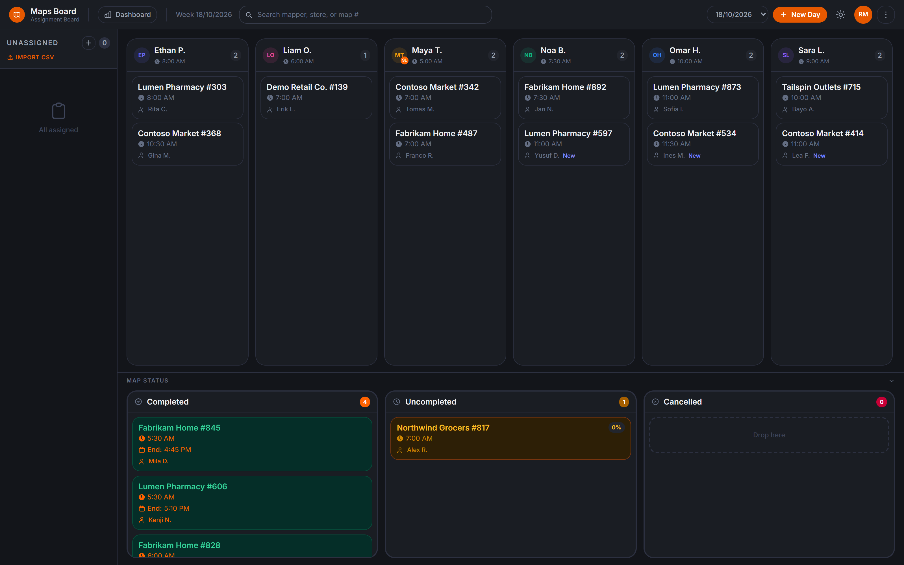
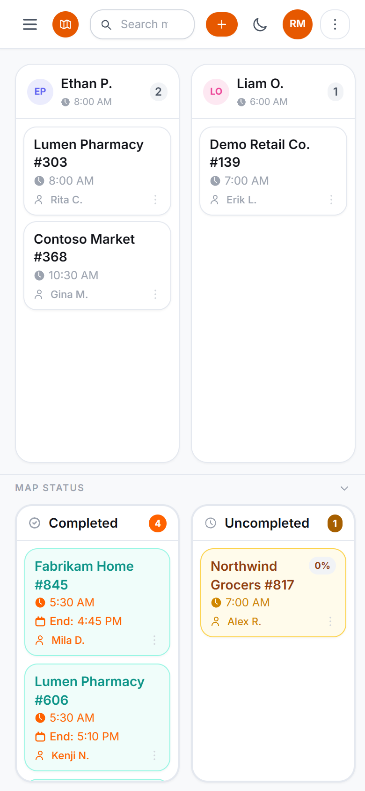
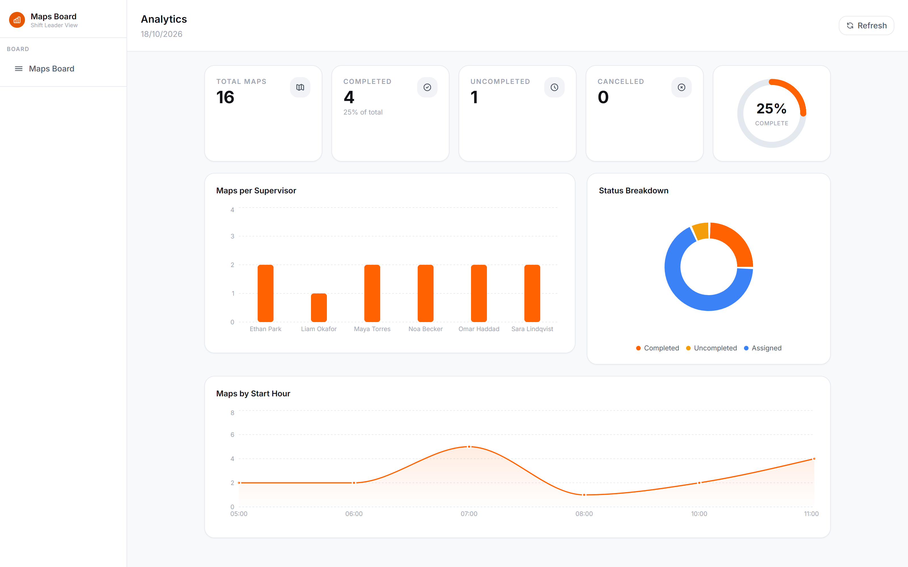
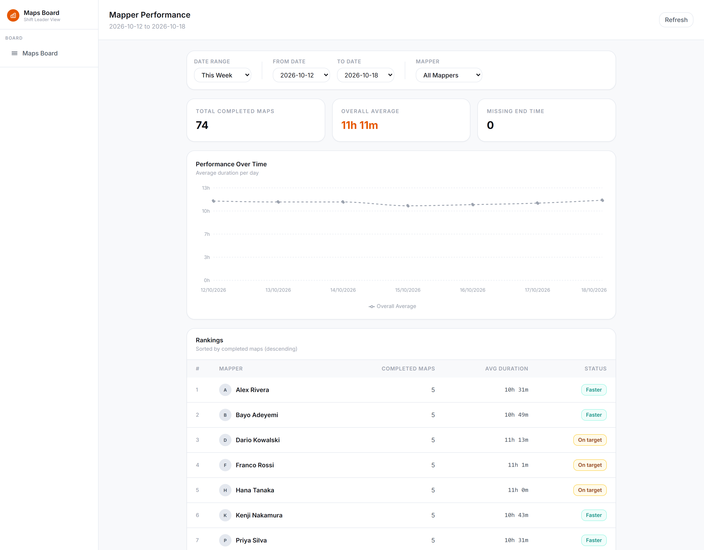
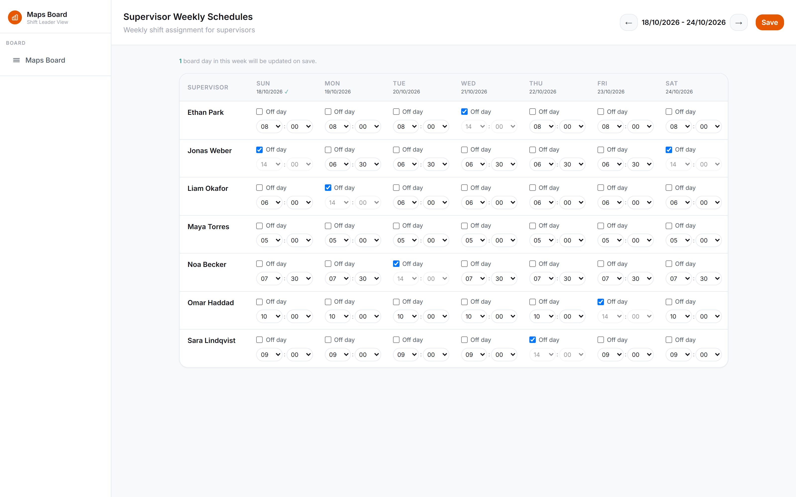
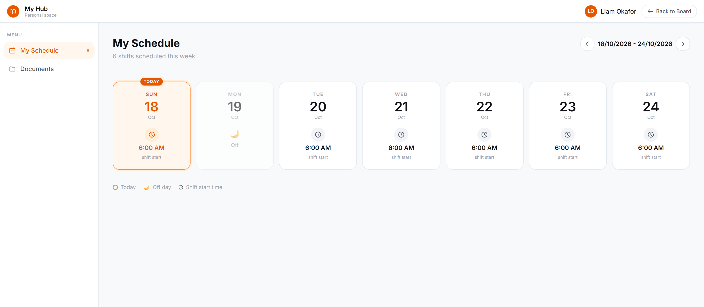

# Maps Board: Shift Assignment Dashboard (Oriient)

**Status:** deployed internally, handed over to the Product team · **Role:** self-initiated, designed and built solo (all commits are mine)

> **About the screenshots:** they come from the real application, running locally against an invented dataset. Every customer, site, supervisor and mapper name on them is fictional. Two UI lines that name a real customer and the company email domain are hidden, and the internal documents page isn't shown. Customer details and internal data are left out of this write-up.

---

## The problem

Oriient is an indoor-positioning company. Its operations team works through a daily list of scheduled jobs ("maps"), each overseen by one supervisor. Supervisors start their shifts at different times, so every day the team has to:

split the day's maps between the supervisors on shift,
make sure no supervisor gets a map that starts before their shift does,
spread maps with new team members evenly so no supervisor is overloaded,
track each map until it's completed, partly completed or cancelled, and see how long maps take.

## What I built

A web app the team uses to plan and track the day:

1. **Schedule:** a manager sets each supervisor's weekly shift start times or off days.
2. **Create the day:** a new board day is created from the schedule, and the day's maps are imported from a CSV.
3. **Assign:** maps are dragged onto supervisor columns, or distributed automatically with one click. The board won't let a map land on a supervisor whose shift hasn't started by the map's start time.
4. **Track:** during the shift, supervisors mark their own maps as completed, uncompleted (with a percentage) or cancelled. Every open board updates live.
5. **Review:** dashboards show the day's status, maps per supervisor, and per-mapper average completion time against the team's target. Data can be exported to CSV or Excel.

## Architecture

| Component | What it does |
|---|---|
| Board UI | Drag-and-drop columns (one per supervisor on shift), an unassigned list and status lanes. Applies changes immediately and saves them in order in the background |
| API routes | Check the sign-in token, apply role rules, then read or write board days, schedules and map states. They also handle CSV import, export and the analytics queries |
| Supervisor hydration | Board data doesn't store supervisor details. When a day is read, names, avatars and shift times are joined in from the user and weekly schedule tables |
| Board repository | One interface with two implementations: Postgres via Supabase, and an in-memory one for local development and tests |
| Postgres + Realtime | Each map's placement is one row: its state plus the supervisor it's assigned to. Clients subscribe to changes on that table and update the board live |
| Auth | Google sign-in limited to the company domain, with four roles: supervisor, shift leader, manager and admin |

## Key screens

**Assignment board.** One column per supervisor on shift, sorted by shift start, with the unassigned list on the left and status lanes underneath. Cards show the site, start time, mapper, a "New" badge for new mappers, and the end time once a map is completed.

**Dark mode and phone layout.** The board works in a dark theme and on a phone, where the sidebar collapses into a menu.

| Dark mode | Phone |
|---|---|
|  |  |

**Analytics.** A snapshot of the day: totals by status, a completion ring, maps per supervisor and maps by start hour.

**Mapper performance.** Each mapper's average time from start to completion over a date range, labelled against the team's target window. Maps with a missing end time are counted separately instead of skewing the average.

**Weekly schedules.** Managers set each supervisor's start time (in 15-minute steps) or an off day for the week. Saving updates any board days that already exist in that week.

**My schedule.** A supervisor's personal view of their shifts for the week.

## Engineering decisions worth mentioning

1. **The assignment rules are small, tested functions.** The rule that a supervisor's shift start must be at or before the map's start time is one pure function. The board checks it on every drop, and a drop that breaks it sends the map back to the unassigned list. Automatic distribution is a greedy algorithm:
   - maps with the fewest eligible supervisors go first,
   - new mappers are capped per supervisor so they spread evenly,
   - each map goes to the least-loaded eligible supervisor, with ties going to the earliest shift.

   Both functions have unit tests.
2. **Live updates through one row per map.** Each map's placement (its state plus the supervisor it's assigned to) lives in its own row. A database constraint ties the "assigned" state to having a supervisor. Moving a card or changing its status is sent as a patch for that single map, Supabase Realtime sends the row change to every open board, and clients update just that card. A client ignores the echo of its own writes for a short window, and it batches a full refresh when the supervisor list changes.
3. **Supervisors are joined in when a day is read, not copied into it.** Profiles and shift times come from the user and weekly schedule tables each time a day is loaded. Saving a schedule only updates the affected days' supervisor rows. If a supervisor is removed from a day, only their map rows change, and those maps go back to unassigned. An earlier version rewrote whole boards on schedule changes, and a race in that path could empty a board. This design fixed it.
4. **Permissions are enforced on the server.** Supervisors can only change the status of maps assigned to them, and only on the current day. The server checks this against the database on every request. Managers can edit the full board and browse past days, while everyone else can only read the current day. Tests cover access for each route.
5. **The company-domain restriction is enforced at four layers:**
   - a Google sign-in hint,
   - a check in the client,
   - a check on every API request, where the bearer token is verified with Supabase Auth,
   - a database trigger and constraint on the users table.

   Removing any single check still doesn't let an outside account in.
6. **The data layer can be swapped out.** All persistence goes through a single repository interface, with an in-memory implementation for local development. There are 105 Vitest tests across 25 files covering the rules, CSV parsing, schedules, route access and export.
7. **Day-to-day details.**
   - **CSV import** accepts common header variants and reports errors by row number.
   - **Export** produces CSV or Excel.
   - **Edits** show immediately and are saved one at a time in order, so a slow request can't overwrite a newer change.
   - **Shuffle** has a one-step undo.

## Result

The board is deployed internally and used by the mapping operations team to plan and track each day. I handed it over to the Product team. I'm not publishing usage or time-saved figures, because I don't have a measured baseline to back them up.

## Stack

TypeScript · Next.js (App Router) · React · Supabase (Postgres, Auth, Realtime) · Tailwind CSS · dnd-kit · Recharts · SheetJS · Vitest · Vercel

The code belongs to my employer, so it isn't public. I'm happy to walk through the design on a call.
