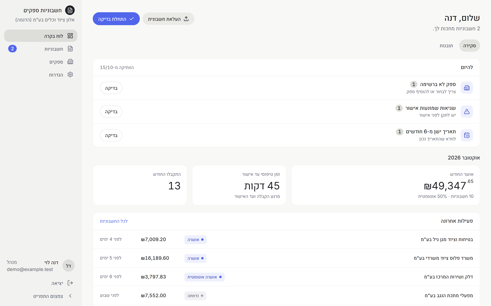
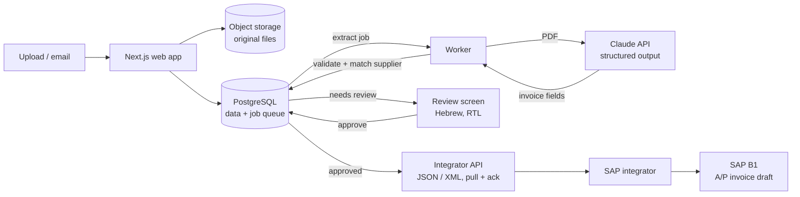
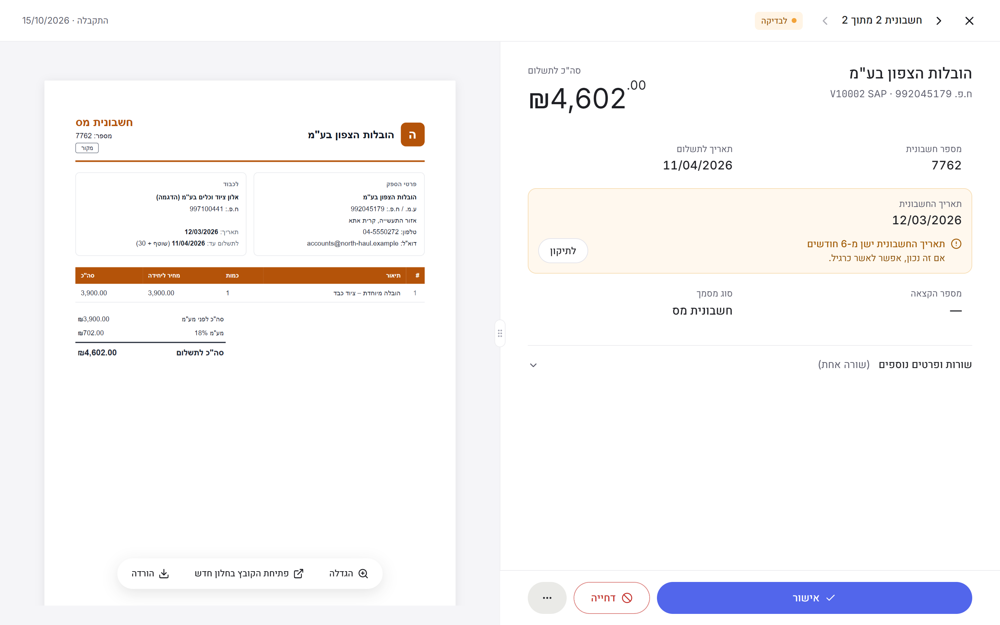
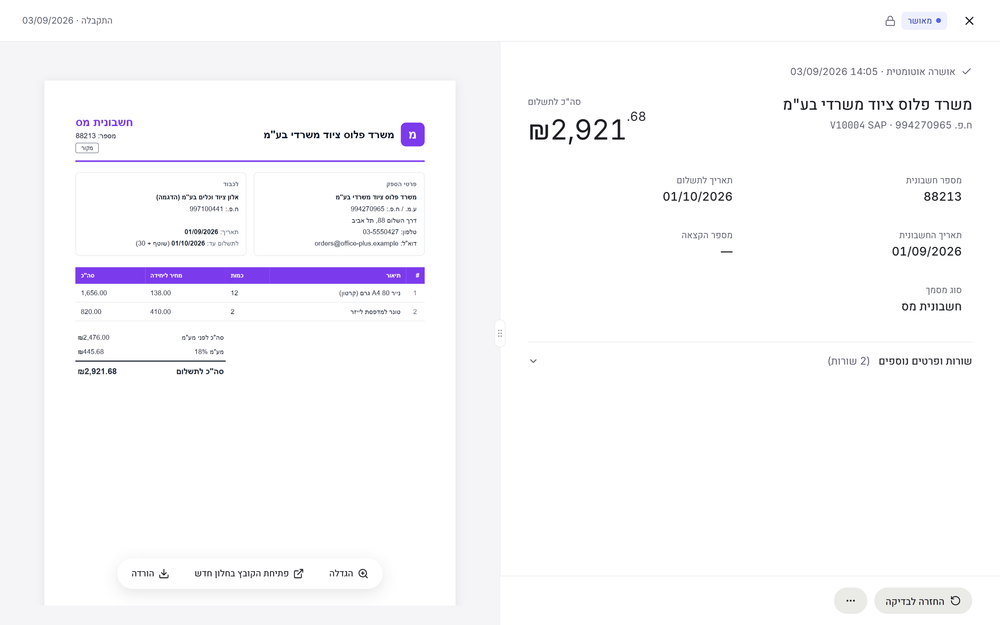
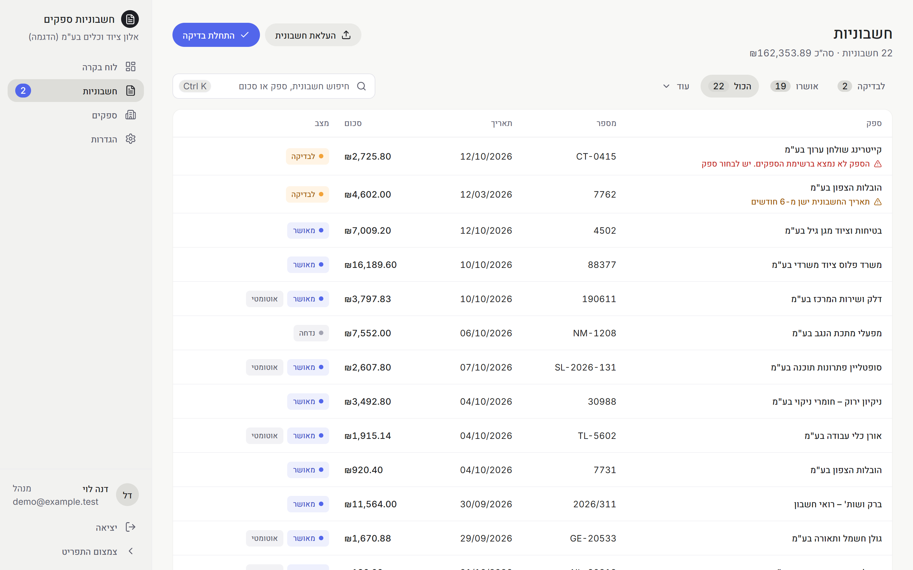
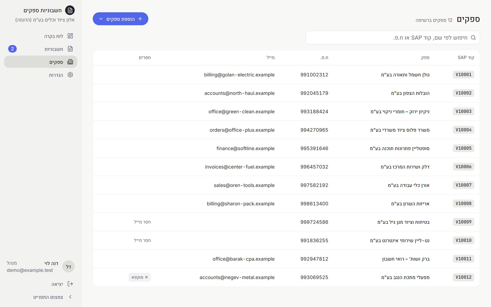
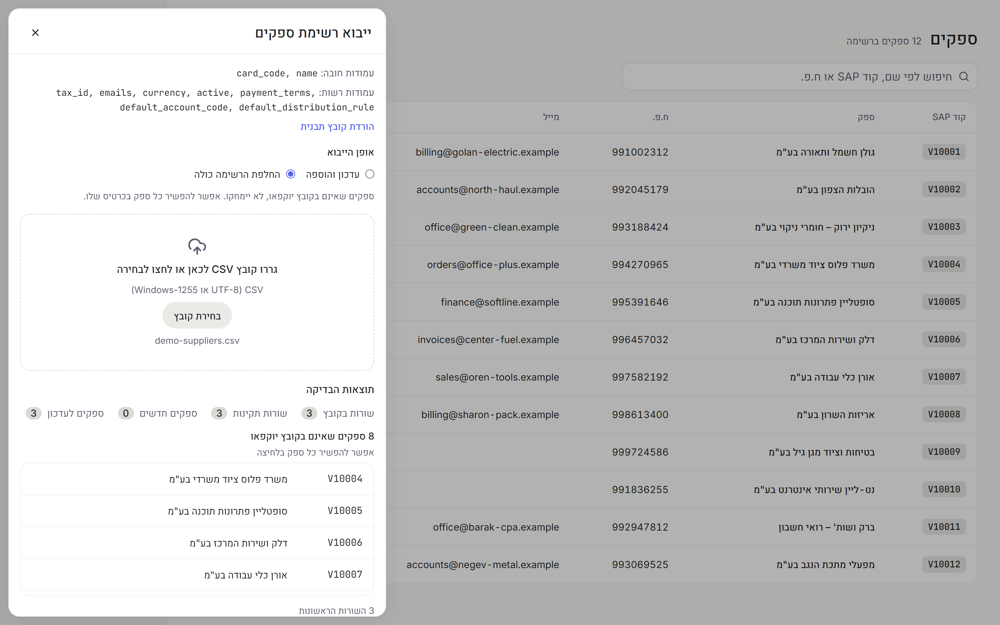
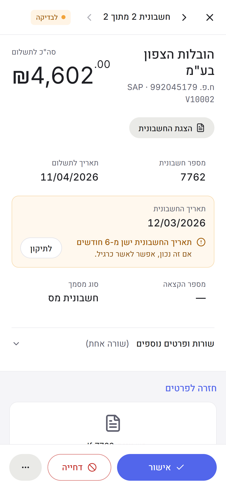

# AI Invoice Intake for SAP Business One

**Status:** in development, tested on a first customer's real invoices, with an SAP integrator partner · **Role:** sole developer, end to end (product, design, code)

> All screenshots on this page come from a demo company with invented data. No real invoices, suppliers or people are shown.

## The problem

Israeli companies running SAP Business One receive dozens to hundreds of supplier invoices a month as PDFs, almost all in Hebrew. Someone opens each one and types the supplier, invoice number, dates, lines, VAT and totals into SAP by hand. It is slow, error-prone, and the checks that matter (is the tax ID right, do the totals add up, is the allocation number there, is this a duplicate) depend on whoever is typing.

## What I built

A multi-tenant SaaS that turns a supplier invoice PDF into clean, validated data ready for SAP, with a person approving anything that isn't certain.

1. **Intake.** A team uploads PDFs or images (drag anywhere on the page). Each file is stored once (deduplicated by hash) and queued. Email intake through a per-company forwarding address is next.
2. **Extraction.** A background worker sends the document to Claude with a strict structured-output schema: supplier, buyer, invoice number, dates, payment terms, allocation number, every line (description, supplier item code, quantity, price, line total, VAT) and the totals.
3. **Validation.** Pure, unit-tested rules check what an accountant would: Israeli tax-ID check digits, VAT rate by date (17% → 18% from 2025), lines vs. totals, VAT math, rounding, allocation-number requirements, dates, duplicates, document type.
4. **Supplier matching.** The supplier is matched to the company's SAP supplier list by tax ID, email or names the system has learned from earlier reviews.
5. **Review.** Anything uncertain lands in a Hebrew, right-to-left review screen: the document on one side, the extracted fields on the other, every problem shown inside the field it belongs to with a one-click fix. Clean invoices from known suppliers can be approved automatically, with presets the company chooses.
6. **Handover to SAP.** Approved invoices are exposed as a versioned JSON/XML contract through an API the SAP integrator pulls from and acknowledges. The integrator creates the A/P invoice drafts in SAP B1. **The system itself never writes to SAP**: a clear boundary that keeps the ERP side in the integrator's hands.

## Architecture

| Part | What it does |
|---|---|
| **Web app** (Next.js App Router) | Review UI, dashboard, suppliers, settings, platform admin, the integrator API |
| **Worker** (Node, pg-boss) | Extraction, validation and matching jobs; crash-safe with sweepers that pick up stuck work |
| **Core** (pure TypeScript) | The invoice model, all validation rules, supplier matching and the JSON/XML serializers, with no I/O, fully unit-tested |
| **PostgreSQL** (Drizzle ORM) | All business data and the job queue; every customer row carries its company id |
| **Auth** (Supabase Auth) | Sign-in only; companies, roles and invitations live in our own tables |
| **Object storage** (S3-compatible) | The original files, served through short-lived signed URLs |

## Screens

| Needs review | Approved |
|---|---|
|  |  |

The review screen is the core of the product: a resizable 50/50 split, the PDF drawn page by page (pdf.js) on the left, and on the right a summary, the key fields (click to edit in place) and one section with the lines and everything else. Problems sit inside the field they concern; approving moves straight to the next invoice in the queue.

| Suppliers | Safe import from SAP |
|---|---|
|  |  |

| Phone | Phone |
|---|---|
|  |  |

## Engineering decisions worth mentioning

- **Tenant isolation by construction.** Every table with customer data has the company id, every query goes through tenant-scoped repository helpers, and the company is derived only from the verified session or API key, never from a request body.
- **Money is never a float.** `numeric(18,2)` in the database, `decimal.js` in code, exact decimal strings in the contract. Totals across currencies are summed in SQL.
- **A versioned contract, the source of truth in code.** The invoice model is a Zod schema; a test keeps the published JSON Schema and XSD in sync with it. Version 1.1 added signed line amounts after a real supplier sent a consolidated invoice with a −₪22,056 credit line that the first version could not represent.
- **LLM output is treated as untrusted input.** Structured output with a schema, `stop_reason` checked (refusals, truncation), every value re-validated and normalised (dates, Hebrew number formats, signs), uncertain fields flagged for the reviewer instead of guessed.
- **Measured, not assumed.** An evaluation harness on real invoices: header-field accuracy went from 98.8% to 100% (88/88 fields) after prompt iterations, line amounts 100%, at about $0.035 per document with batch pricing.
- **Hebrew and right-to-left done properly.** LTR islands for numbers, codes and emails; a font-fallback bug that silently drew all Hebrew in Arial; and canvas text in an RTL page shifting every PDF glyph by its own width, found and fixed.
- **Human in the loop where it matters.** Auto-approval only for clean invoices from known suppliers; anything unusual (credit lines, unknown suppliers, old dates) always goes to a person, with a full audit trail of who did what.

## Stack

TypeScript (strict) · Node 24 · pnpm monorepo · Next.js App Router · PostgreSQL · Drizzle ORM · pg-boss · Zod · Anthropic Claude API · Supabase Auth · S3-compatible storage · pdf.js · Tailwind CSS + shadcn/ui · Vitest (2,000+ tests) · Docker

## Status and next steps

Being tested with a first customer. Next: email intake through a per-company forwarding address, hosting, and the integrator's go-live on SAP B1.

The source code is private (commercial product); happy to walk through it on a call.
