# Tsevet: AI Teammates for Small Businesses

**Status:** working and in use by me, no paying clients yet · **Role:** founder and sole developer (product, design, code)

> All screenshots come from the real application, running locally against an invented sample business. Every person, message and email address on them is fictional. No real accounts or client data are shown.

## The problem

Small business owners in Israel handle their own follow-ups, quotes, social posts and invoice reminders between everything else, in Hebrew or Arabic, on a phone or a Windows PC. A general AI chat can help them write a message, but it doesn't keep track of anything. And giving a bot access to email raises an obvious question: what stops it sending the wrong thing to a client?

## What I built

Tsevet (צוות, Hebrew for "team") gives a business a team of named AI workers, each with a face, a job and a personality. The owner works with them in a Hebrew-first, right-to-left web chat, with Arabic and English as well. Workers do the work and draft what goes out, and nothing leaves the business until the owner approves it.

1. **Hire.** The owner picks a job, a face and a name. The first worker is the team lead, and the current plan allows three. Each job has its own short setup: a few questions, the app it needs, and a first recurring job to offer.
2. **Talk.** Each worker has one ongoing chat with streamed replies. Workers talk in the first person, like coworkers, and the face they were given sets their grammar in Hebrew and Arabic.
3. **Hand off.** Any worker can pass a task to any teammate. The work runs on the server, so it continues with the app closed, and the result comes back to the chat it started in.
4. **Connect.** Gmail, Google Calendar and Google Sheets connect in one click. Workers can read from them right away.
5. **Approve.** Anything that sends or changes something appears as a card above the composer, with the exact recipient and text. The owner approves, edits or rejects it, and the server runs the stored version once.
6. **Repeat.** Any worker can propose a recurring job. The owner approves it on the same kind of card, and each result lands in that worker's chat.
7. **Remember.** The team shares a memory the owner can read and delete. Owners can also import what another AI assistant already knows about them.

It's sold done-for-you: Kassum AI sets up each business, connects what it needs and keeps it running, for a setup fee plus a monthly retainer.

## Architecture

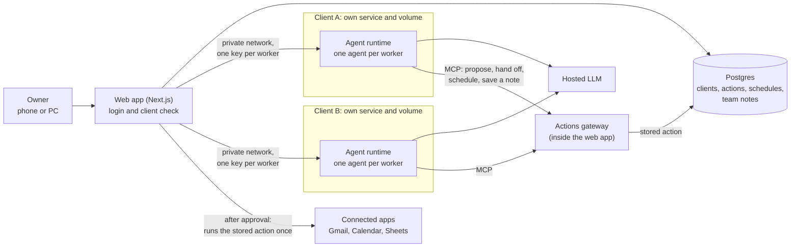

| Part | What it does |
|---|---|
| **Web app** (Next.js App Router) | The only public part. Chat, approvals, team page and settings. It checks the login and the client on every request, then streams the reply back |
| **Actions gateway** (MCP server in the web app) | The only way a worker can act: propose an action, hand off a task, propose a job, save a note. The credentials that send things stay here |
| **Agent runtime** (self-hosted) | One isolated service and volume per client, with no public address, pinned to an exact image. Each worker has its own key and its own short list of tools |
| **Postgres** (Supabase, with row-level security) | Logins, clients, pending actions, handoffs, schedules, team notes and usage. Chat history stays in each client's own service, with no second copy |
| **Scheduler** | The clock lives on the web server, which starts each job, counts it toward the monthly cap and puts the result in the worker's chat |
| **Provisioning** (Python) | One script adds a client: service, volume, keys, tenant row and owner invite. Another turns our own worker definitions into runtime config, so a runtime change only touches one place |

## Screens

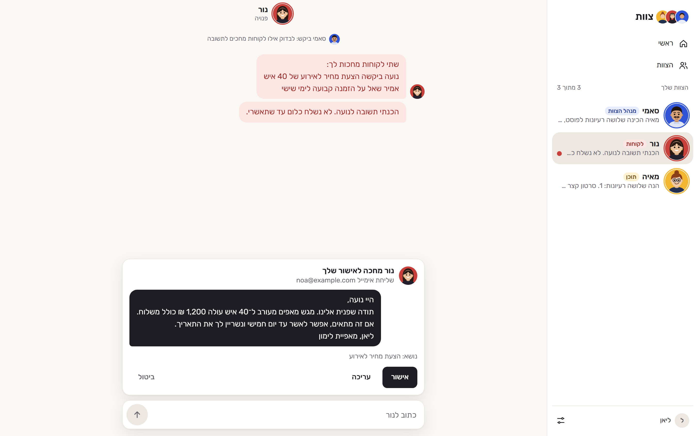

The approval card is the core of the product. It shows the recipient and text from the stored action, never the worker's own summary, and the owner can approve, edit or reject it.

| Handoffs | A recurring job waiting for approval |
|---|---|
| 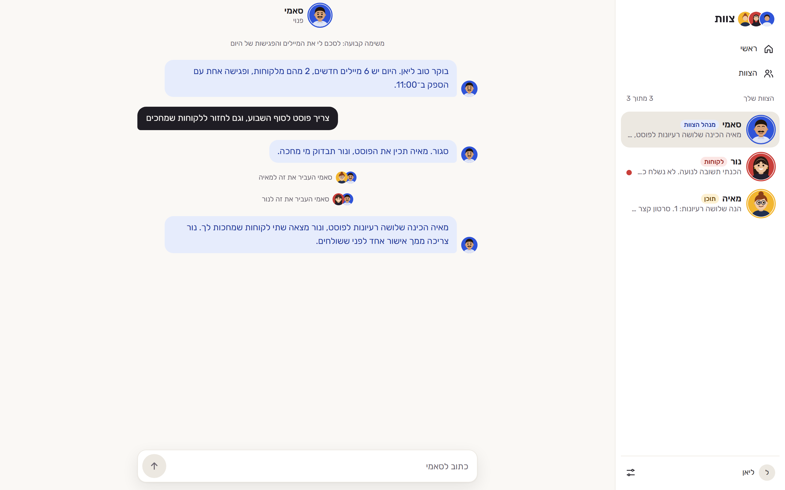 | 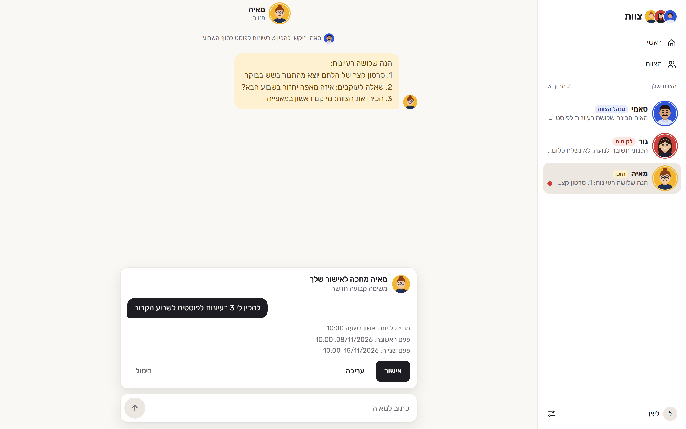 |

The team lead splits the work and reports back. A recurring job's card shows the next two run times, worked out by the server, so a worker's wording can't hide the real timing.

| The team and its recurring jobs | Hiring a worker |
|---|---|
| 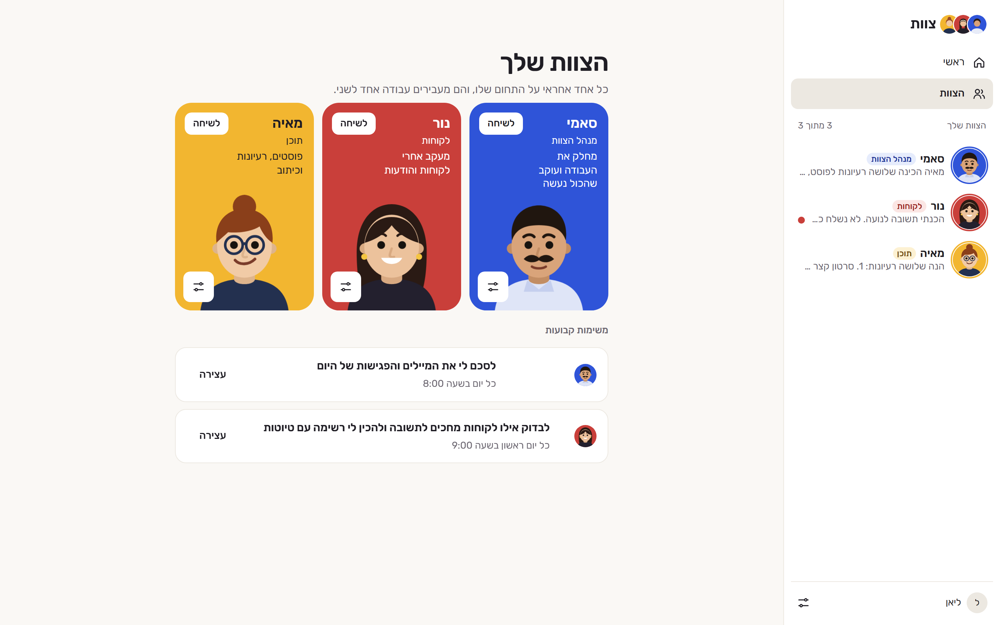 | 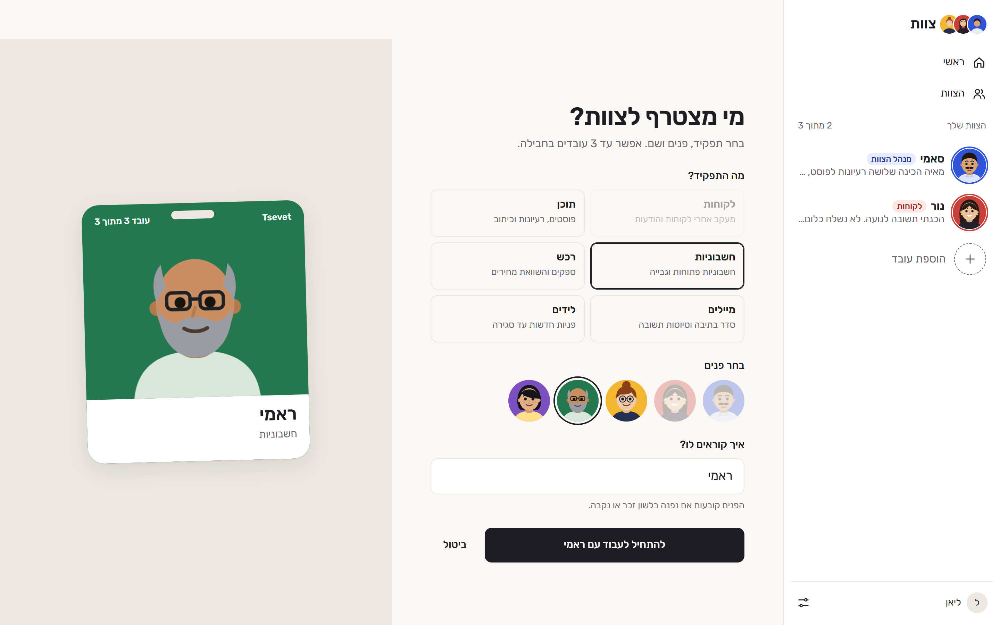 |

| What the team remembers | Connections |
|---|---|
| 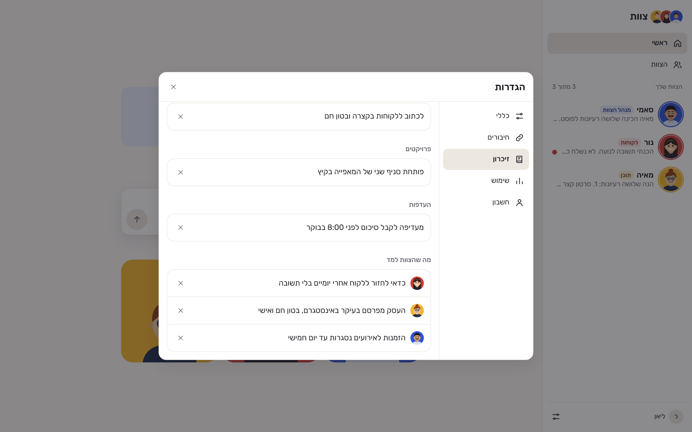 | 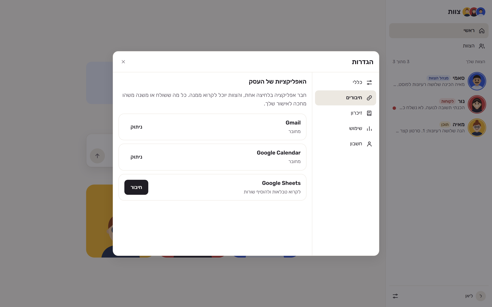 |

| English | Arabic |
|---|---|
| 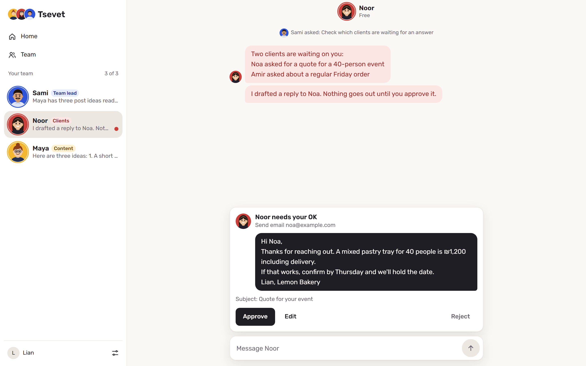 | 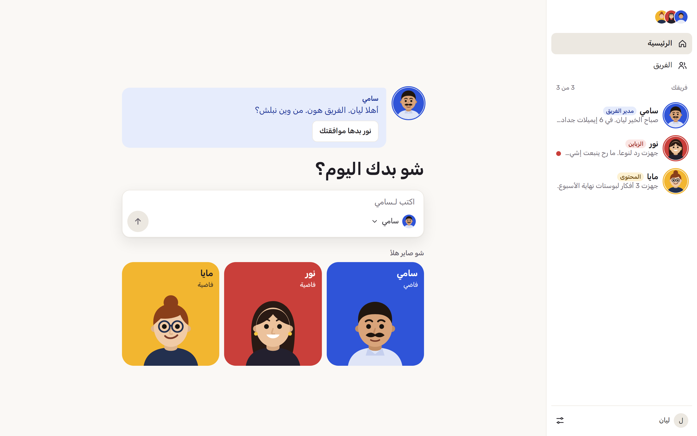 |

| Dark mode | Phone | Phone |
|---|---|---|
| 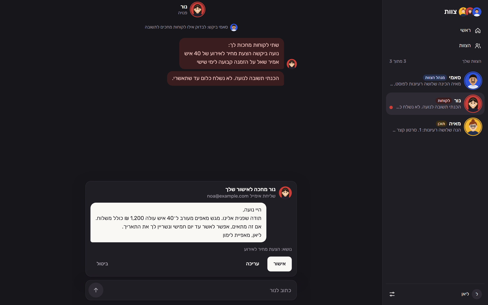 | 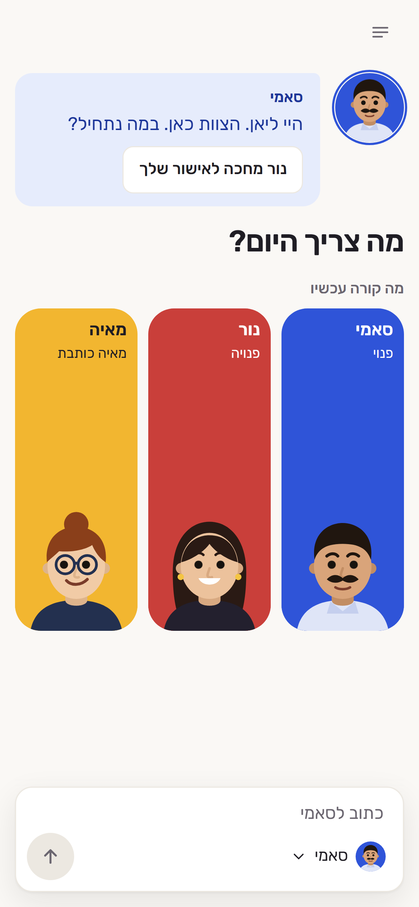 | 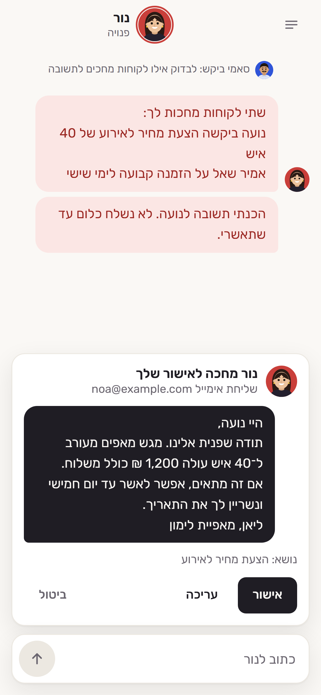 |

## Engineering decisions worth mentioning

- **Approval is enforced by the server, not by a prompt.** A prompt can be talked around, but a worker can't misuse a key it doesn't have. Workers hold no sending credentials. They propose an action, the server stores it with a hash and an expiry, and after approval the server runs that stored copy once. Tested end to end on a real Gmail account: a worker read mail, proposed a send, and the email went out only after the card was approved.
- **Deny by default.** An allowed list in code decides what workers can do in each app. Read actions run at once, actions that send or change something ask first, and anything not on the list is refused. Only the server calls the connected apps, so a poisoned email can't talk a worker into sending directly. Text read from apps is treated as information, not instructions.
- **Client isolation by construction.** Each client has its own service, volume and keys. The client always comes from the login or the worker's token, never from anything the model says. Row-level security sits behind the server's own check as a second wall. Tested with a second real client: its tokens saw none of the first client's jobs, its keys got a 401 from the first client's agents, and an outside login saw 0 rows.
- **No dangerous tools.** Workers have an explicit tool list with no shell, code, file or browser access. A 33-point check runs inside the real container after every change that could affect this, including real model turns and a blocked-tool canary, because the config alone doesn't prove what actually runs.
- **A real team needs limits.** A handoff chain stops at 3 steps, a worker can't pass a task back to whoever gave it, and at most 5 tasks run at once. Jobs run at most hourly, up to 20 per client, and a job missed during a restart runs on the next tick unless it's over 6 hours late. A monthly token cap stops chats, handoffs and jobs with a plain message.
- **Memory the owner can actually see.** The runtime's private memory files have no API, so they couldn't be shown or wiped. I turned them off, and everything a worker remembers now lives in team notes the owner can read and delete. Removing a worker wipes their chats, jobs, approvals and notes.
- **Client messages stay out of log files.** The runtime logged the start of every message, and that text could sit in rotated logs long after a chat was deleted. I closed that gap and tested it with a secret word: after deleting the chat, it was nowhere on the volume or in the deploy logs.
- **Importing memory uses no AI.** The owner copies a prompt into another assistant, pastes the answer back and ticks what to keep. Plain rules read it, so importing costs nothing. Lines that look like passwords, card numbers or keys can't be imported, personal details start unticked, and imported items are labelled as background that can't change any rule or approval.
- **Hebrew and Arabic first, not translated.** All UI text lives in one string file, and CSS uses logical start/end properties only, with a lint check that enforces it. Hebrew and Arabic strings change with the worker's gender. Hebrew copy avoids English tech terms, which also break right-to-left text.
- **Upgrades on purpose.** The agent runtime is pinned by digest and never updates itself. I practised an upgrade, a volume restore and a rollback on my own account. That showed a deploy and a restore aren't one atomic step, so the rollback procedure now reverts the image first and restores second. That new order hasn't been tested yet.
- **Workers stay honest.** Asked directly, a worker says it's an AI and never claims to be a person, tested in Hebrew, Arabic and English. That's a behaviour rule and not a security wall, so nothing secret ever goes in a prompt.

## Stack

TypeScript · Next.js (App Router) · React · Supabase (Postgres, Auth) · Python · Docker · Railway · Model Context Protocol (MCP) · a self-hosted agent runtime · a hosted LLM · a managed app-connection service

## Status and next steps

Working end to end on real accounts and in use by me. There are no paying clients yet, so I have no client results or usage figures to publish. Next: a small pilot with first clients from my own contacts, a proper sign-in email, notifications while the app is closed, file uploads in chat, and a full check on Android phones and Windows PCs. WhatsApp as a channel is parked for now.

The source code is private (commercial product); happy to walk through it on a call.
